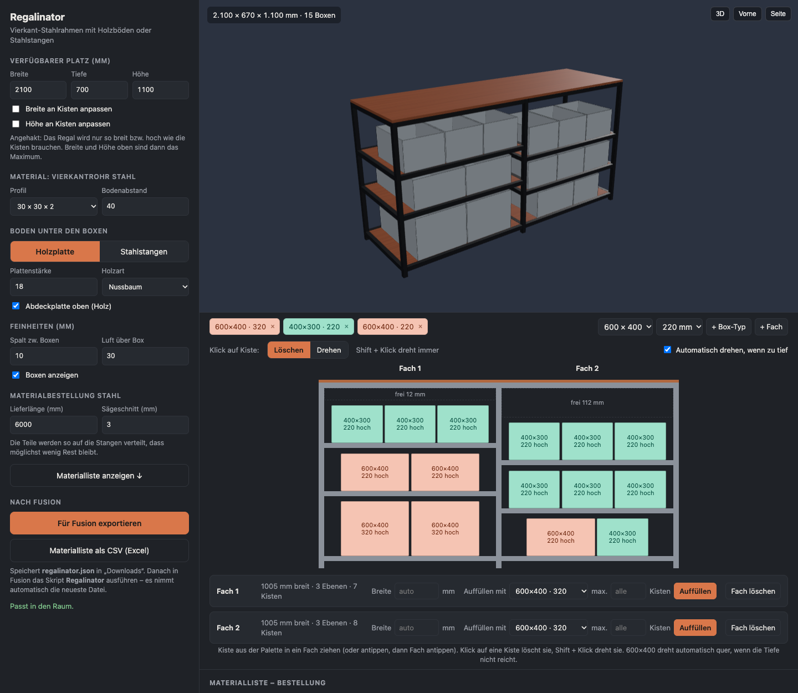

# Regalinator

Ein Konfigurator im Browser für Regale aus **Vierkant-Stahlrohr**, in die **Euroboxen** (Euronorm-Behälter, z. B. 600 × 400 und 400 × 300 mm) genau hineinpassen – mit 3D-Vorschau, Materialliste mit Schnittplan und Export nach **Autodesk Fusion**.

**Direkt im Browser ausprobieren: [monsenieurgateau.github.io/regalinator](https://monsenieurgateau.github.io/regalinator/)**

## Was er kann

- **Baukasten:** Kisten aus der Palette per Drag and Drop (oder antippen) in die Fächer setzen, Größen frei mischen – auch auf einer Ebene. Klick auf eine Kiste löscht sie, mit dem Werkzeug „Drehen“ oder Shift + Klick wird sie gedreht.
- **Automatisch drehen:** 600 × 400-Kisten stellen sich quer, wenn die Regaltiefe nicht reicht.
- **Auffüllen:** Ein Fach mit einer gewählten Kiste bis oben füllen, optional mit Höchstzahl.
- **Kopieren und einfügen:** Ein fertig belegtes Fach kopieren und in ein anderes Fach einfügen (überschreibt dessen Inhalt).
- **Maße:** Regal füllt den verfügbaren Raum – oder passt Breite, Tiefe und Höhe einzeln automatisch an die Kisten an.
- **Böden:** Holzplatte (Nussbaum, Eiche, Kirsche, Birke Multiplex) oder Vierkant-Auflagestangen unter jeder Kiste. Optional Abdeckplatte oben. Bodenabstand 0 = unterste Kisten stehen direkt auf dem Boden.
- **Materialliste:** Bestellmenge in Stangen einstellbarer Lieferlänge (z. B. 6 m) inklusive Sägeschnitt, optimierter Schnittplan, Verschnitt, Gewicht, Holzfläche.
- **Excel-Export:** Übersicht mit bemaßter Zeichnung (vorne und seitlich) und 3D-Bild, Bestellung, Zuschnitt Stahl, Schnittplan, Belegung der Fächer.
- **Projektdatei:** Regal als Datei speichern und später wieder öffnen.
- **3D-Ansicht:** Kisten auf Wunsch halb durchsichtig, um den Rahmen dahinter zu sehen.
- **Prüfung:** Alles, was nicht passt (zu breit, zu hoch, zu tief), wird sofort mit Begründung gemeldet.

## Benutzen

### Im Browser

Online unter [monsenieurgateau.github.io/regalinator](https://monsenieurgateau.github.io/regalinator/) – oder `index.html` herunterladen und lokal im Browser öffnen. Es ist keine Installation nötig; für die 3D-Ansicht wird [three.js](https://threejs.org) aus dem Internet geladen. Alle Einstellungen werden im Browser gespeichert.

### In Autodesk Fusion

1. **Einmalig das Skript einrichten:** Das Repository herunterladen (grüner Knopf **Code → Download ZIP**) und entpacken. In Fusion **Dienstprogramme → Zusatzmodule → Skripte und Zusatzmodule** öffnen, beim Reiter *Skripte* auf **+** klicken und den Ordner `fusion/Regalinator` auswählen.
2. Im Regalinator auf **„Für Fusion exportieren“** klicken – die Datei `regalinator.json` landet im Ordner *Downloads*.
3. In Fusion im Dialog *Skripte und Zusatzmodule* **Regalinator** auswählen und **Ausführen** klicken. Das Skript nimmt die neueste Exportdatei aus *Downloads* (findet es keine, kann man sie auswählen), baut das Regal auf – Stahl, Holz und Kisten als getrennte Körpergruppen – und meldet das Ergebnis in einem Fenster.

> Wichtig: Die JSON-Datei **nicht** über *Datei → Öffnen* in Fusion laden – das kann Fusion nicht. Immer über das Skript gehen. Auch die Projektdatei (`*.regalinator-projekt.json`) ist kein Fusion-Export.

## Aufbau des Regals

- 4 Pfosten pro Fachgrenze, je Ebene ein Rahmen aus Quer- und Tiefenriegeln.
- Holzvariante: Platte bündig im Rahmen eingelegt.
- Stahlvariante: je Kiste zwei Vierkantstangen in die Tiefe, oben bündig mit dem Rahmen.
- Die Kisten stehen vollständig innerhalb des Rahmens (Kistentiefe + 2 × Profil + Spalt).

> Hinweis: Die Statik wird nicht berechnet. Bei großen Spannweiten, schweren Kisten oder Bodenabstand 0 (unten kein Rahmen) das Regal entsprechend auslegen und an der Wand sichern.

## Dateien

| Pfad | Inhalt |
|---|---|
| `index.html` | Der komplette Konfigurator (eine Datei, kein Build) |
| `fusion/Regalinator/` | Fusion-Skript, das die exportierte JSON-Datei einliest |
| `docs/` | Bilder für diese Seite |

## Lizenz

[MIT](LICENSE)
